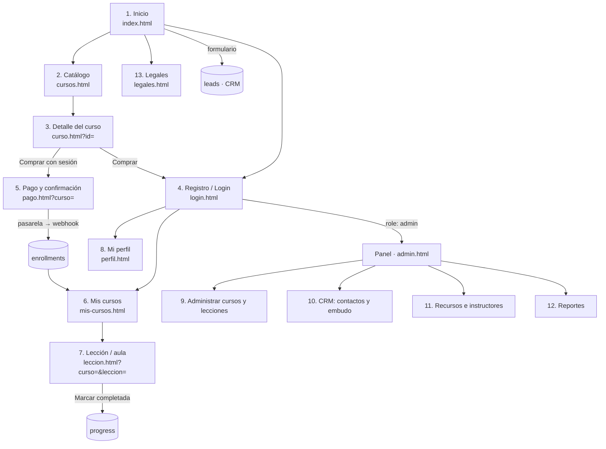

# Mapa del sitio · 13 pantallas

| # | Pantalla | Archivo | Quién | Sprint |
|---|---|---|---|---|
| 1 | Inicio | `index.html` | Visitante | 1 |
| 2 | Catálogo | `cursos.html` | Visitante | 1 |
| 3 | Detalle del curso | `curso.html?id=` | Visitante | 1 y 4 |
| 4 | Registro e inicio de sesión | `login.html` | Visitante | 2 |
| 5 | Pago y confirmación | `pago.html` | Estudiante | 4 |
| 6 | Mis cursos | `mis-cursos.html` | Estudiante | 3 |
| 7 | Lección (aula) | `leccion.html` | Estudiante | 3 |
| 8 | Mi perfil | `perfil.html` | Estudiante | 3 |
| 9 | Administrar cursos | `admin.html#cursos` / `#lecciones` | Administrador | 3 |
| 10 | CRM: contactos y embudo | `admin.html#crm` | Administrador | 4 |
| 11 | Recursos | `admin.html#recursos` / `#instructores` | Administrador | 5 |
| 12 | Reportes | `admin.html#reportes` | Administrador | 5 |
| 13 | Legales | `legales.html` | Visitante | 5 |

## Wireframes

Los bocetos de las 5 pantallas clave (inicio, catálogo, detalle, mis cursos y lección) se guardan en `docs/wireframes/` como imágenes (foto del boceto a mano o exportación de Figma). *Pendiente: subir las fotos.*
